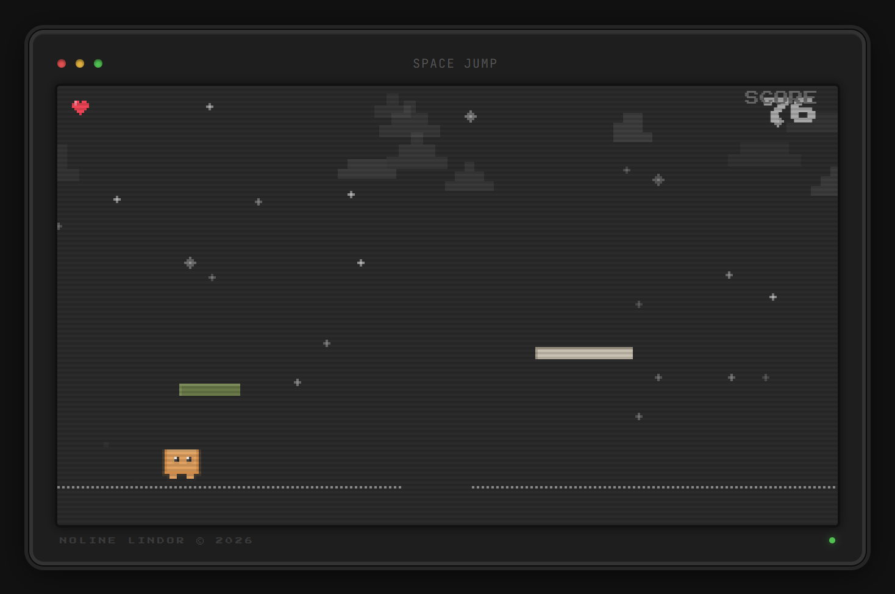

# Space Jump

An endless retro pixel platformer that runs in the browser. Jump across platforms in space, collect hearts and survive the spaceship boss fights. No install, no build step: one HTML file.

**[Play it live](https://space-jump-ten.vercel.app)**

## How to play

| Action | Keyboard | Touch |
|:--|:--|:--|
| Jump / double jump | `Space` `↑` `W` | Tap |
| Move (boss fight) | `←` `→` `A` `D` | |
| Pause | `Esc` | |
| Volume (in pause menu) | `←` `→` | |

- You start with **3 lives**. Collect hearts on platforms to gain more.
- The game speeds up the further you get.
- At **500 points** a spaceship boss appears. Grab the hammer from the arena platforms and hit it three times while dodging its lasers. After that the bosses keep coming, each one further out.
- Your high score is saved in your browser.

## Built with

`HTML` `JavaScript` `Canvas API` `Web Audio`

Everything lives in `index.html`: game loop, physics, pixel rendering and generated boss music. Sound effects and music tracks are in `/sounds`.

## Run it locally

Download or clone the repo and open `index.html` in your browser. That's it.

---

Made by <a href="https://nolinelindor.com">Noline Lindor</a>. Fan project, the pixel character is inspired by the Claude Code terminal mascot.
